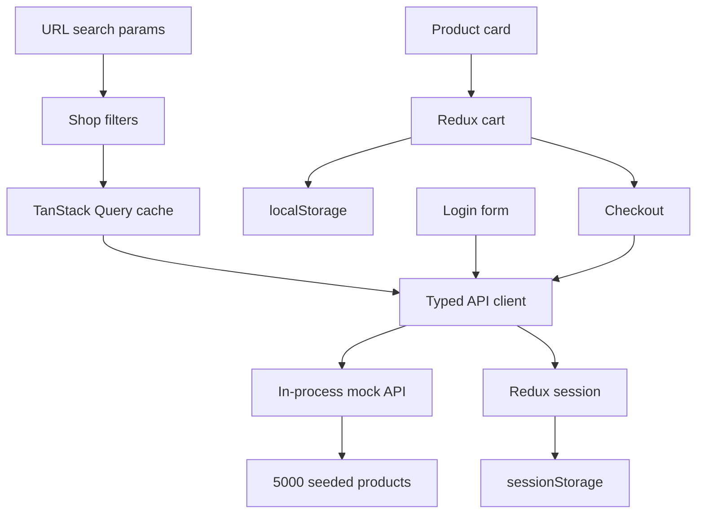

# Architecture

## Data flow

## Folder structure

- `src/types.ts`: shared contract and discriminated request status
- `src/data/products.ts`: deterministic seed
- `src/data/mockServer.ts`: mock endpoints, errors, idempotency and stock
- `src/data/client.ts`: single request boundary and user-safe errors
- `src/store.ts`: Redux cart and auth session
- `src/hooks.ts`: reusable hooks
- `src/App.tsx`: UI and routing
- `src/test`: behavior tests

## Where state lives

- **Server (simulated):** products, stock, orders, idempotency map; mutable mock state persisted in browser localStorage
- **Client:** cart and session in Redux; localStorage cart, sessionStorage token and pending checkout key
- **URL:** search, category, sort, in-stock flag and page
- **Cache:** product list/detail results in TanStack Query
- **Component:** login form values, checkout busy/error state

## Three patterns

1. **Adapter** (`data/client.ts`): shields UI from mock backend details and translates error shape.
2. **Custom hooks** (`hooks.ts`): debounce, local storage and scroll-listener lifecycle reused without duplicated effects.
3. **Unidirectional state updates** (`store.ts`): Redux actions update cart/session; selectors derive count and total.

## Trade-off to defend

Mock requests use a local adapter, so the app can be demoed without server configuration. This is easy to learn and test but does **not** exercise real network behavior or secure server-side sessions. Production would replace the adapter with `fetch` against a backend while preserving the contract.

The stock feed in `data/stockFeed.ts` polls the mock source, retries interrupted reads with backoff, and updates TanStack Query product data. It is a local simulation, not a network stream.
