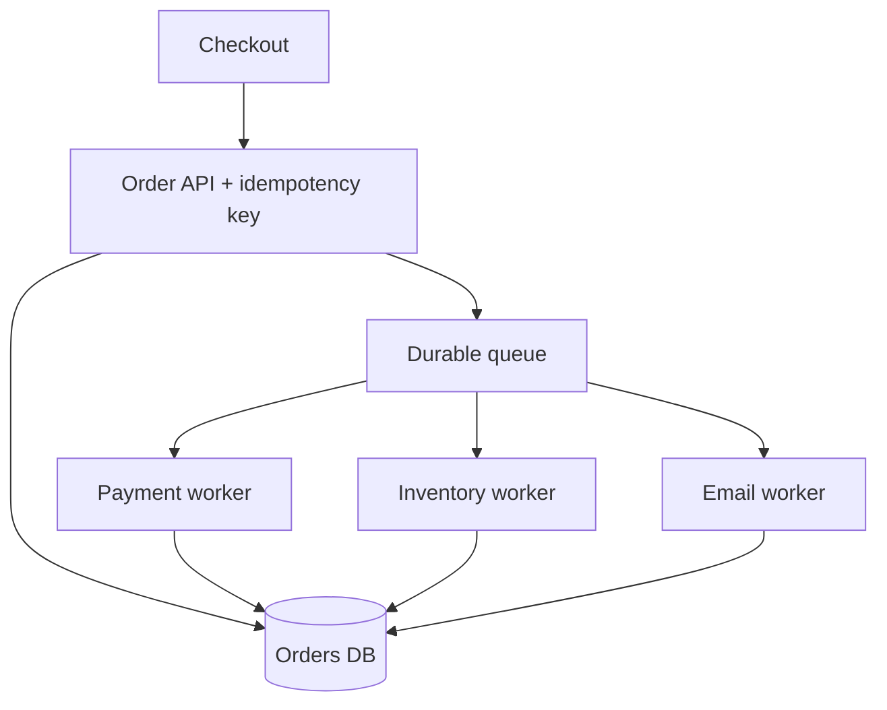

# Queued order design (proposed architecture)

The API writes an order and enqueues a job, returning `queued` quickly. Queue workers can retry independently if payment, inventory or email services are slow. If email fails, payment and inventory should not be undone solely for an email outage; the email job retries and eventually goes to a dead-letter queue. For real payments, unique idempotency keys must be persisted in the database and forwarded to the payment provider. The D3-2 demo deduplicates retries with an in-memory key map, which is **not durable across process restarts** and therefore not sufficient for real financial transactions. Production must also use transactions, stock reservation and reconciliation.
